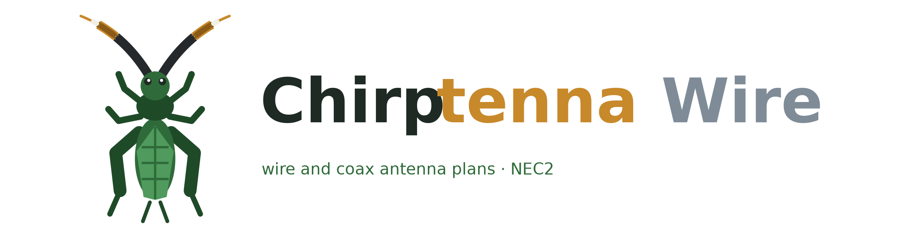

<picture>
  <source media="(prefers-color-scheme: dark)" srcset="img/logo-wire-oscuro.png">
  
</picture>

# Chirptenna Wire

Build plans for **wire, rod and coaxial-cable antennas** (dipole, J-pole, Koch J-pole, discone, coax dipole,
CoCo collinear) for a given frequency: dimensions, cut list with trimming margin, materials and assembly, backed
by an NEC2 simulation, plus the `.nec` model to open in 4nec2 or xnec2c.

**Status: alpha, under development (phase 1).** Nothing has been measured with a VNA yet: every type is labelled
"Simulated" or "Unvalidated" and the drawings say so. Scope and phases: [`docs/PROPUESTA.md`](docs/PROPUESTA.md)
(Spanish); drawing design: [`docs/PLANOS.md`](docs/PLANOS.md) (Spanish).

| Type | Status | Drawing |
|---|---|---|
| Half-wave dipole | **Simulated** (checked against theory, not measured) | 1 A4 sheet: overview, cut list, simulated SWR, 1:1 centre detail |
| Wire J-pole | **Simulated** (not measured) | 2 A4 sheets: summary and 1:1 detail of the U bottom, matching section and feed tap |

Examples in [`docs/ejemplos/`](docs/ejemplos/) (PDF, `diseno.json`, `.nec`).

```powershell
python -m wire plano jpole 145 --diametro 2 --salida jpole_145.pdf --guardar jpole_145.json
python -m wire plano --desde jpole_145.json --salida jpole_145.svg
python -m wire nec jpole 145 --diametro 2 --salida jpole_145.nec
python -m wire recomendar 145 --ganancia 8 --tamano 2
```

`recomendar` ranks the types that meet a minimum gain (dBi) and a maximum size (m) at that frequency, using the theoretical
reference gains. It is also on the "Choose an antenna" screen of the desktop app and the web ("Not sure which to pick?").

The core (`wire/modelo.py`, `generadores.py`, `nec.py`, `diseno.py`, `planos/`) is pure Python and also runs in
Pyodide (planned web lite). The simulation engine (`wire/motor.py`, `ajuste.py`) needs
[PyNEC](https://pypi.org/project/PyNEC/) and is desktop-only.

## Install

Python 3.11 or later.

```powershell
python -m venv .venv
.venv\Scripts\python.exe -m pip install PyNEC numpy fpdf2 pytest
.venv\Scripts\python.exe -m pytest
```

**Print drawings at 100 % ("actual size")** and check the 80 mm ruler before using the 1:1 details.

## Moving an antenna between Wire and Chirptenna VNA

Simulated and measured data travel as ordinary files; nothing to configure.

| What | From → to | How |
|---|---|---|
| **Simulated S11** (`.s1p`, 50 Ω) | Wire → VNA | In Wire: `python -m wire s1p <type> <MHz> --salida sim.s1p`, or the **Download simulated S11** button in the Simulation tab. In Chirptenna VNA (Advanced mode): **Compare with a Touchstone file** → pick the `.s1p`, measure your antenna, and the simulation shows in grey with the resonance offset |
| **Measurement** (`.s1p`) | VNA → Wire | In Chirptenna VNA (Advanced mode): **Touchstone (.s1p)**. In Wire, **Medir** tab → **Abrir .s1p medido**: it compares against the simulation and the design becomes "Measured" only if the deviation is ≤ 2 % |
| **Cable VF** (`cable_*.json`) | VNA → Wire | In Chirptenna VNA: **Coax and stubs** → **Download the VF for Chirptenna Wire**. In Wire: **Abrir cable medido** (Design tab, coax antennas) or `--cable-medido cable.json`; simulate again so the lengths follow |
| **The whole design** (`diseno.json`) | Wire ↔ Wire (desktop and web) | Saved with `--guardar` or in the Plan tab; opens in the desktop app or the web lite and gives the same drawing |

Suggested workflow: design and simulate in Wire, download the simulated `.s1p`, build the antenna and measure it in Chirptenna VNA with
that `.s1p` loaded as a reference, bring your measured `.s1p` back to Wire, and if it resonates lower or higher than simulated, the VNA
tells you how much to lengthen or shorten. The simulated `.s1p` is free space (or the design's ground), **with no cable, mast or
surroundings**: it is a reference, not a measurement.

## Licence

Code: [AGPL-3.0](LICENSE). Published designs and drawings: CC BY-NC 4.0, see
[`LICENSE-DISENOS.md`](LICENSE-DISENOS.md). Part of the [Chirptenna](https://github.com/sqtactical/chirptenna)
family (PCB antennas).
