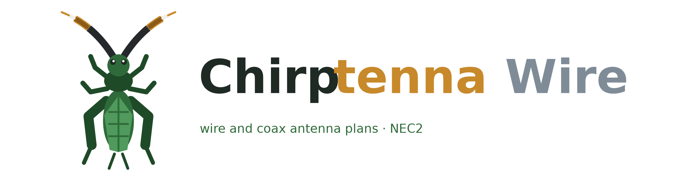
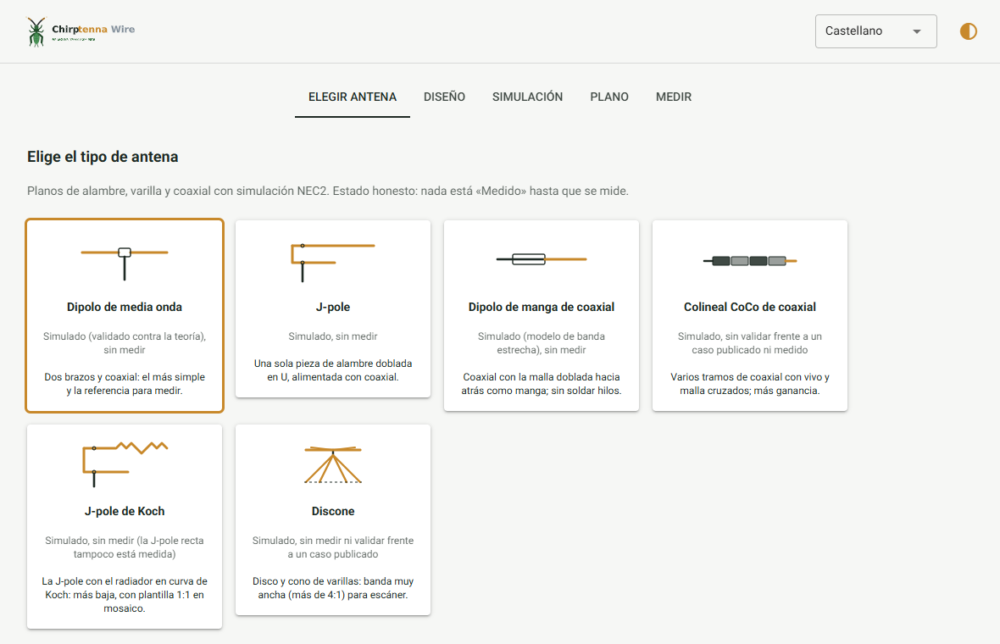
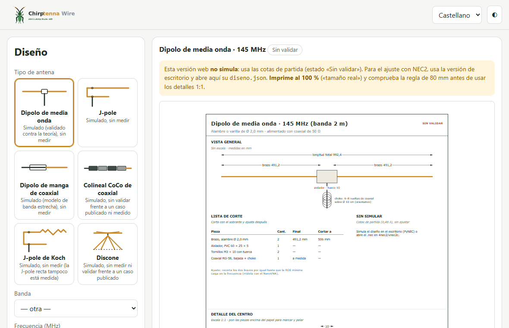

<picture>
  <source media="(prefers-color-scheme: dark)" srcset="img/logo-wire-oscuro.png">
  
</picture>

# Chirptenna Wire

Planos para construir antenas de **alambre, varilla y cable coaxial** (dipolo, J-pole, J-pole de Koch, discone, dipolo
de coaxial, colineal CoCo) para una frecuencia: cotas, lista de corte con margen de ajuste, materiales y montaje, con la
simulación (NEC2) que los respalda y el modelo en `.nec` para abrirlo en 4nec2 o xnec2c.

**Estado: en desarrollo, fase 1.** El alcance, el modelo (hilos y líneas de transmisión), las fases, la identidad visual y
las decisiones pendientes están en [`docs/PROPUESTA.md`](docs/PROPUESTA.md); el diseño de los planos, en
[`docs/PLANOS.md`](docs/PLANOS.md).

## Qué hay ahora

| Tipo | Estado | Plano |
|---|---|---|
| Dipolo de media onda | **Simulado** (validado contra la teoría, sin medir) | 1 hoja A4: vista general, lista de corte, ROE simulada, detalle del centro a 1:1 |
| J-pole de alambre | **Simulado** (sin medir) | 2 hojas A4: resumen y detalle 1:1 del fondo de la U, el adaptador y la toma |
| Dipolo de manga de coaxial | **Simulado** (modelo de banda estrecha, sin medir) | 1 hoja A4: tramos, lista de corte, ROE simulada y pelado 1:1; cable y VF en el cajetín |
| Colineal CoCo (2–8 tramos de coaxial) | **Simulado, sin validar frente a un caso publicado** ni medido | 2 hojas A4: tramos sin escala con su longitud física y eléctrica, red en L, y detalle 1:1 de la unión cruzada |
| J-pole de Koch | **Simulado** (sin medir; la J-pole recta tampoco) | Resumen y plantilla del alambre a 1:1: una hoja, **A3** o **mosaico de A4** con solape, marcas de registro y mapa de montaje |
| Discone (8 o 16 varillas) | **Simulado** (sin medir ni validar frente a un caso publicado) | 1 hoja A4: cotas, lista de corte, ROE y plantilla 1:1 de la pieza central y del ángulo del cono |

Ejemplos generados con el motor en [`docs/ejemplos/`](docs/ejemplos/) (PDF, `diseno.json` y `.nec`).

```powershell
python -m wire plano jpole 145 --diametro 2 --salida jpole_145.pdf --guardar jpole_145.json
python -m wire plano --desde jpole_145.json --salida jpole_145.svg
python -m wire nec jpole 145 --diametro 2 --salida jpole_145.nec
```

- `wire/modelo.py`, `wire/generadores.py`, `wire/nec.py`, `wire/diseno.py` y `wire/planos/`: **Python puro**, corren
  igual en escritorio y en la web lite (Pyodide). `diseno.json` guarda cotas, resultados y el bloque `plano`.
- `wire/motor.py` y `wire/ajuste.py`: solo escritorio, con [PyNEC](https://pypi.org/project/PyNEC/). El ajuste busca la
  resonancia del dipolo y, en la J-pole, el brazo largo, el brazo corto y la toma que dan la ROE mínima a 50 Ω.
- `wire/planos/`: descripción vectorial de las hojas en mm reales → SVG (vista previa) y PDF con
  [fpdf2](https://py-pdf.github.io/fpdf2/) (que carga en Pyodide con micropip). Fuente DejaVu Sans incluida.

Validación (NEC2, espacio libre, alambre de 2 mm):

| | Resonancia o mínimo de ROE | Z | S11 a f | Ganancia |
|---|---|---|---|---|
| Dipolo λ/2 hilo fino (radio 0,001 λ) | longitud 0,474 λ | 71,8 Ω | — | 2,14 dBi |
| J-pole 145 MHz | 145,00 MHz | 50,0 + j0,0 Ω | < −40 dB | 2,40 dBi |
| J-pole 435 MHz | 435,00 MHz | 50,0 + j0,0 Ω | < −40 dB | 2,72 dBi |

La J-pole se ajusta con ~250 segmentos a 145 MHz y ~170 a 435 MHz (3 × min(λ/50, separación)): con menos, el mínimo de
ROE se mueve de 0,3 a 0,8 % al subdividir; con el doble de segmentos se mueve menos de 0,1 %.

## Instalación

Python 3.11 o posterior. En Windows, crea el entorno fuera de OneDrive (las rutas largas fallan):

```powershell
py -3.14 -m venv $env:LOCALAPPDATA\chirptenna-wire\venv
& $env:LOCALAPPDATA\chirptenna-wire\venv\Scripts\python.exe -m pip install PyNEC numpy fpdf2 pytest
& $env:LOCALAPPDATA\chirptenna-wire\venv\Scripts\python.exe -m pytest
```

Sin PyNEC, los planos salen con las cotas de partida y el estado «Sin validar»; las pruebas del motor se saltan. La CI
pasa también el `.nec` por nec2c en Linux (misma impedancia que PyNEC a ≤ 0,5 %) y genera un plano dentro de Pyodide
(misma descripción vectorial que en escritorio).

**Imprime los planos al 100 % («tamaño real»)** y comprueba la regla de 80 mm antes de usar los detalles 1:1.

## Interfaz de escritorio




En Windows, `instalar.bat` crea el entorno fuera de OneDrive, instala los paquetes y deja un `iniciar.bat`. A mano:

```powershell
python -m pip install nicegui PyNEC numpy fpdf2
python gui/app.py            # http://127.0.0.1:8090 (solo en este ordenador)
```

Pestañas **Elegir** (galería de tipos con su estado), **Diseño** (frecuencia o banda, cable y VF medido, papel, unidades; *Simular y
ajustar* usa PyNEC en un proceso aparte), **Simulación** (Z, ROE, ganancia y curva), **Plano** (vista de cada hoja y descargas de
PDF, SVG, `.nec` y `diseno.json`) y **Medir** (enlace a Chirptenna VNA, importar un `.s1p` y compararlo con la simulación). Un diseño
solo pasa a **«Medido»** si la resonancia o el mínimo de ROE medidos caen a ≤ 2 % de los simulados. `CHIRPTENNA_VNA_URL` cambia la
dirección de Chirptenna VNA (por defecto `http://localhost:8765/`).

## Idiomas

Los planos y la web salen en castellano, inglés, francés y alemán (`--idioma es|en|fr|de` en la línea de comandos; selector en la web). El castellano es el texto fuente; los catálogos están en `wire/idiomas/` y `python herramientas/i18n.py faltan` comprueba que no falte ninguna traducción (lo pasa la CI). **Las traducciones las hizo Claude y conviene que las revise un hablante nativo.**

## Web lite



**https://sqtactical.github.io/Chirptenna-Wire/** · `web/` es una versión que corre entera en el navegador (Pyodide, sin instalar nada): se elige el tipo y la frecuencia
y se descarga el PDF, el SVG, el `.nec` o el `diseno.json`. **No simula**: usa las cotas de partida («Sin validar»);
un `diseno.json` ajustado en escritorio se abre y da el mismo plano. Para probarla en local:

```powershell
python herramientas/construir_web.py
python -m http.server 8096 --directory salidas/web --bind 127.0.0.1
```

Se publica a mano con `gh workflow run web.yml --ref main` (`.github/workflows/web.yml`, GitHub Pages).

## Licencia

Código bajo [AGPL-3.0](LICENSE). Los diseños y planos que publica el autor, bajo CC BY-NC 4.0 ([LICENSE-DISENOS.md](LICENSE-DISENOS.md)). English: [README.en.md](README.en.md).

Forma parte de la familia [Chirptenna](https://github.com/sqtactical/chirptenna) (antenas impresas en PCB) y
Chirptenna VNA (asistente de medida con el NanoVNA).
