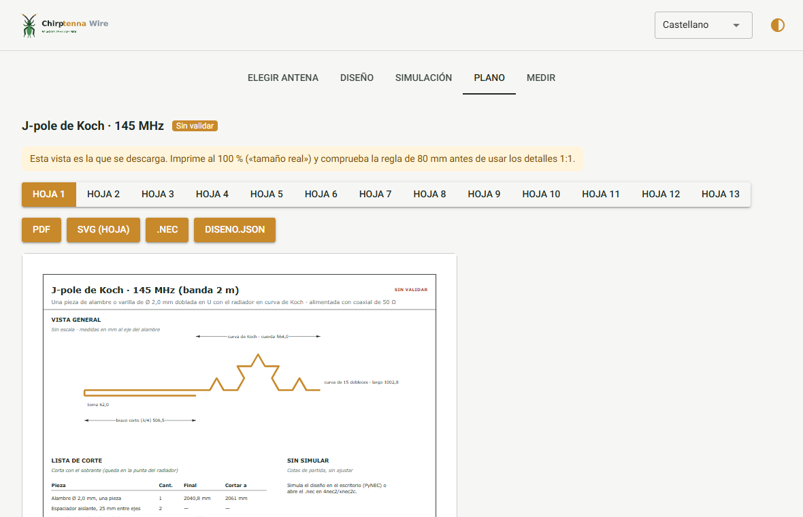

<picture>
  <source media="(prefers-color-scheme: dark)" srcset="img/logo-wire-oscuro.png">
  
</picture>

# Chirptenna Wire

Planos para construir antenas de **alambre, varilla y cable coaxial** (dipolo, J-pole, J-pole de Koch, discone, dipolo
de coaxial, colineal CoCo) para una frecuencia: cotas, lista de corte con margen de ajuste, materiales y montaje, con la
simulación (NEC2) que los respalda y el modelo en `.nec` para abrirlo en 4nec2 o xnec2c.

**Estado: en desarrollo, fase 1.** El alcance, el modelo (hilos y líneas de transmisión), las fases, la identidad visual y
las decisiones pendientes están en [`docs/PROPUESTA.md`](docs/PROPUESTA.md); el diseño de los planos, en
[`docs/PLANOS.md`](docs/PLANOS.md).

## Qué hay ahora

| Tipo | Estado | Plano |
|---|---|---|
| Dipolo de media onda | **Simulado** (validado contra la teoría, sin medir) | 1 hoja A4: vista general, lista de corte, ROE simulada, detalle del centro a 1:1 |
| J-pole de alambre | **Simulado** (sin medir) | 2 hojas A4: resumen y detalle 1:1 del fondo de la U, el adaptador y la toma |
| Dipolo de manga de coaxial | **Simulado** (modelo de banda estrecha, sin medir) | 1 hoja A4 y el **patrón del extremo del cable a 1:1**: tramos, lista de corte, ROE simulada y pelado; cable y VF en el cajetín |
| Colineal CoCo (2–8 tramos de coaxial) | **Simulado, sin validar frente a un caso publicado** ni medido | 2 hojas A4 más el **patrón del coaxial a 1:1** (tramo y punta, con los pelados, en A4 apaisadas con solape): tramos sin escala con su longitud física y eléctrica, red en L y detalle 1:1 de la unión cruzada |
| J-pole de Koch | **Simulado** (sin medir; la J-pole recta tampoco) | Resumen y plantilla del alambre a 1:1: una hoja, **A3** o **mosaico de A4** con solape, marcas de registro y mapa de montaje |
| Discone (8 o 16 varillas) | **Simulado** (sin medir ni validar frente a un caso publicado) | 1 hoja A4: cotas, lista de corte, ROE y plantilla 1:1 de la pieza central y del ángulo del cono |
| Ground plane (radiador λ/4 y 4 radiales a 45°) | **Simulado** en espacio libre, sin medir | 1 hoja A4: cotas, lista de corte, ROE y plantilla 1:1 de la brida del conector (SO-239 o N, cotas orientativas) y del ángulo de los radiales |
| Dipolo en V invertida | **Simulado** en espacio libre, sin medir | 1 hoja A4: cotas, lista de corte, ROE y vértice a 1:1 con el ángulo |
| Yagi de 3 a 15 elementos (dipolo plegado, eje de plástico o metal) | **Simulado**, sin medir ni validar frente a un caso publicado; la corrección del eje metálico sale de la bibliografía, no del modelo | 1 hoja A4 (más una de elementos y eje si hay más de 3 o eje metálico): elementos y separaciones, lista de corte, ROE y el centro del plegado a 1:1 |
| Bicónica | **Simulado**, sin medir ni validar frente a un caso publicado | 1 hoja A4: cotas, lista de corte, ROE y pieza central a 1:1 |
| Torniquete en X (dipolos cruzados) | **Simulado** (razón axial 0 dB en el cénit, en espacio libre), sin medir | 1 hoja A4: vista, lista de corte (brazos y línea de 75 Ω), ROE y centro del cruce a 1:1 |
| Dipolo de HF | **Simulado** sobre suelo real (εr y σ típicos, sin medir en tu terreno), sin medir | 2 hojas A4: la antena con ROE por banda y el balun o choke 1:1 con su comprobación con el NanoVNA |
| V invertida de HF | **Simulado** sobre suelo real, sin medir | igual que el dipolo de HF |
| Dipolo en abanico multibanda (2 a 5 bandas) | **Simulado** sobre suelo real, sin medir; los hilos se acoplan, hay que ajustar en la antena | 2 hojas A4 |
| Dipolo de dos bandas con trampas | **Simulado** con trampas ideales (Q = 100), sin medir; la trampa real hay que ajustarla | 3 hojas A4: antena, balun y bobina y condensador de la trampa |
| G5RV con escalerilla | **Simulado**, sin medir; con línea ideal; no adapta sola en todas las bandas (se usa con acoplador) | 2 hojas A4 |
| Vertical de HF con 8 radiales elevados | **Simulado** sobre suelo real, sin medir; ROE ≈ 1,1 a 7,1 MHz con R ≈ 45 Ω, pero la ganancia sale ≈ 0 dBi por las pérdidas del suelo | 1 hoja A4 |
| EFHW de HF con transformador 49:1, 64:1 o 9:1 | **Simulado** sobre suelo real con transformador ideal, sin medir; los datos del transformador real son de montajes de aficionados, sin verificar | 3 hojas A4: la antena con la ROE por banda, el transformador (núcleo, vueltas, condensador y dibujo a 1:1) y su ajuste con carga de prueba y NanoVNA |
| Colineal con bobinas de fase (2 a 6 secciones) | **Simulado** en espacio libre con bobinas ideales, sin medir; la bobina real hay que medirla y ajustarla | 2 hojas A4: vista, lista de corte y ROE simulada; y la bobina de fase a 1:1 con su medida y ajuste con el NanoVNA |
| Colineal bibanda 145 / 433 MHz (2 o 4 secciones) | **Simulado** en espacio libre con componentes ideales, sin medir; banda estrecha en 145 MHz | 2 hojas A4: antena con la ROE de las dos bandas, y el enlace bobina + condensador en serie a 1:1 con su medida y ajuste con el NanoVNA |
| Yagi bibanda 145 / 433 MHz | **Simulado** en espacio libre (dos dipolos desde el mismo punto, un solo coaxial; ROE ≈ 1,0 y 6,3 dBi hacia delante en las dos bandas), sin medir; los dos dipolos se acoplan y la banda baja es sensible al largo (2 % = ROE 1,3) | 1 hoja A4: vista, lista de corte, posiciones en el eje y la ROE de cada banda |
| Batwing (dipolo de alas) | **Simulado**, sin medir ni validar frente a un caso publicado | 1 hoja A4: vista, lista de corte (radios y borde), ROE y abanico a 1:1 |

### Ganancia teórica

Ganancia máxima simulada (NEC2) del diseño de cada tipo, que sale también en el cajetín de los planos y en la galería de la web
(`wire/ganancias.json`). Es **de referencia**: espacio libre en VHF/UHF, suelo normal a 10 m en HF, sin mástil ni entorno. Si el diseño trae su
propia simulación, el cajetín da esa.

| Tipo | dBi |
|---|---|
| Dipolo, J-pole, V invertida, ground plane, manga, torniquete | 1,8 a 2,4 |
| Discone, bicónica, batwing | 1,4 / 2,9 / 4,4 |
| Colineal con bobinas de fase, 2 / 3 / 4 / 5 / 6 secciones | 3,3 / 4,8 / 5,5 / 6,2 / 6,7 |
| Colineal bibanda (145 / 433 MHz), 2 y 4 secciones | 2,2 / 3,9 y 3,2 / 4,7 |
| Yagi bibanda (145 / 433 MHz) | 6,2 / 6,3 |
| CoCo de coaxial (4 tramos) | 6,2 |
| Yagi, 3 / 5 / 7 / 10 / 15 elementos | 8,7 / 10,2 / 11,7 / 12,2 / 13,2 |
| HF sobre suelo (dipolo, EFHW, G5RV, trampas, V invertida) | 5,2 a 6,4 |
| Vertical de HF con radiales elevados | 0,0 |

Ejemplos generados con el motor en [`docs/ejemplos/`](docs/ejemplos/) (PDF, `diseno.json` y `.nec`).

```powershell
python -m wire plano jpole 145 --diametro 2 --salida jpole_145.pdf --guardar jpole_145.json
python -m wire plano --desde jpole_145.json --salida jpole_145.svg
python -m wire nec jpole 145 --diametro 2 --salida jpole_145.nec
python -m wire s1p jpole 145 --diametro 2 --salida jpole_145_simulado.s1p
python -m wire recomendar 145 --ganancia 8 --tamano 2
```

`recomendar` ordena los tipos que cumplen una ganancia mínima (dBi) y un tamaño máximo (m, la mayor dimensión de la antena) a esa frecuencia,
con las ganancias teóricas de referencia: sirve para decidir qué construir antes de abrir un plano. También está en la pantalla «Elegir antena» del escritorio y de la web
(«¿No sabes cuál elegir?»), con un botón «Usar» que abre el diseño elegido.

El último saca el S11 simulado en Touchstone (`.s1p`, 50 Ω): cárgalo como referencia en Chirptenna VNA y se superpone a tu medida
con la desviación de la resonancia (también hay un botón en la pestaña Simulación del escritorio).

- `wire/modelo.py`, `wire/generadores.py`, `wire/nec.py`, `wire/diseno.py` y `wire/planos/`: **Python puro**, corren
  igual en escritorio y en la web lite (Pyodide). `diseno.json` guarda cotas, resultados y el bloque `plano`.
- `wire/motor.py` y `wire/ajuste.py`: solo escritorio, con [PyNEC](https://pypi.org/project/PyNEC/). El ajuste busca la
  resonancia del dipolo y, en la J-pole, el brazo largo, el brazo corto y la toma que dan la ROE mínima a 50 Ω.
- `wire/planos/`: descripción vectorial de las hojas en mm reales → SVG (vista previa) y PDF con
  [fpdf2](https://py-pdf.github.io/fpdf2/) (que carga en Pyodide con micropip). Fuente DejaVu Sans incluida.

Validación (NEC2, espacio libre, alambre de 2 mm):

| | Resonancia o mínimo de ROE | Z | S11 a f | Ganancia |
|---|---|---|---|---|
| Dipolo λ/2 hilo fino (radio 0,001 λ) | longitud 0,474 λ | 71,8 Ω | — | 2,14 dBi |
| J-pole 145 MHz | 145,00 MHz | 50,0 + j0,0 Ω | < −40 dB | 2,40 dBi |
| J-pole 435 MHz | 435,00 MHz | 50,0 + j0,0 Ω | < −40 dB | 2,72 dBi |

La J-pole se ajusta con ~250 segmentos a 145 MHz y ~170 a 435 MHz (3 × min(λ/50, separación)): con menos, el mínimo de
ROE se mueve de 0,3 a 0,8 % al subdividir; con el doble de segmentos se mueve menos de 0,1 %.

## Instalación

Python 3.11 o posterior. En Windows, crea el entorno fuera de OneDrive (las rutas largas fallan):

```powershell
py -3.14 -m venv $env:LOCALAPPDATA\chirptenna-wire\venv
& $env:LOCALAPPDATA\chirptenna-wire\venv\Scripts\python.exe -m pip install PyNEC numpy fpdf2 pytest
& $env:LOCALAPPDATA\chirptenna-wire\venv\Scripts\python.exe -m pytest
```

Sin PyNEC, los planos salen con las cotas de partida y el estado «Sin validar»; las pruebas del motor se saltan. La CI
pasa también el `.nec` por nec2c en Linux (misma impedancia que PyNEC a ≤ 0,5 %) y genera un plano dentro de Pyodide
(misma descripción vectorial que en escritorio).

**Imprime los planos al 100 % («tamaño real»)** y comprueba la regla de 80 mm antes de usar los detalles 1:1.

## Interfaz de escritorio




En Windows, `instalar.bat` crea el entorno fuera de OneDrive, instala los paquetes y deja un `iniciar.bat`. A mano:

```powershell
python -m pip install nicegui PyNEC numpy fpdf2
python gui/app.py            # http://127.0.0.1:8090 (solo en este ordenador)
```

Pestañas **Elegir** (galería de tipos con su estado), **Diseño** (frecuencia o banda, cable y VF medido, papel, unidades; *Simular y
ajustar* usa PyNEC en un proceso aparte), **Simulación** (Z, ROE, ganancia y curva), **Plano** (vista de cada hoja y descargas de
PDF, SVG, `.nec` y `diseno.json`) y **Medir** (enlace a Chirptenna VNA, importar un `.s1p` y compararlo con la simulación). Un diseño
solo pasa a **«Medido»** si la resonancia o el mínimo de ROE medidos caen a ≤ 2 % de los simulados. `CHIRPTENNA_VNA_URL` cambia la
dirección de Chirptenna VNA (por defecto `http://localhost:8765/`).

## Llevar y traer una antena entre Wire y Chirptenna VNA

Lo simulado y lo medido viajan en archivos normales; no hay que configurar nada.

| Qué | De → a | Cómo |
|---|---|---|
| **S11 simulado** (`.s1p`, 50 Ω) | Wire → VNA | En Wire: `python -m wire s1p <tipo> <MHz> --salida sim.s1p` o el botón **Descargar S11 simulado** de la pestaña Simulación. En Chirptenna VNA (modo Avanzado): **Comparar con un archivo Touchstone** → elige el `.s1p`, mide tu antena y sale la simulada en gris con la desviación de la resonancia |
| **Medida** (`.s1p`) | VNA → Wire | En Chirptenna VNA (modo Avanzado): **Touchstone (.s1p)**. En Wire, pestaña **Medir** → **Abrir .s1p medido**: compara con la simulación y el diseño pasa a «Medido» solo si la desviación es ≤ 2 % |
| **VF del cable** (`cable_*.json`) | VNA → Wire | En Chirptenna VNA: **Coaxial y stubs** → **Descargar el VF para Chirptenna Wire**. En Wire: **Abrir cable medido** (pestaña Diseño, antenas de coaxial) o `--cable-medido cable.json`; vuelve a simular para que cuadren los largos |
| **El diseño entero** (`diseno.json`) | Wire ↔ Wire (escritorio y web) | Se guarda con `--guardar` o en la pestaña Plano; se abre en escritorio o en la web lite y da el mismo plano |

Pasos recomendados: 1) diseña y simula en Wire, 2) baja el `.s1p` simulado, 3) construye la antena y mídela con Chirptenna VNA con ese
`.s1p` cargado como referencia, 4) vuelve a Wire con tu `.s1p` medido, 5) si resuena más baja o más alta de lo simulado, el propio VNA te
dice cuánto alargar o acortar. El `.s1p` simulado es espacio libre (o el suelo del diseño), **sin cable ni mástil ni entorno**: es una
referencia, no una medida. La antena construida y su entorno mandan siempre.

## Idiomas

Los planos y la web salen en castellano, inglés, francés y alemán (`--idioma es|en|fr|de` en la línea de comandos; selector en la web). El castellano es el texto fuente; los catálogos están en `wire/idiomas/` y `python herramientas/i18n.py faltan` comprueba que no falte ninguna traducción (lo pasa la CI). **Las traducciones las hizo Claude y conviene que las revise un hablante nativo.**

## Web lite


**https://sqtactical.github.io/Chirptenna-Wire/** · `web/` es una versión que corre entera en el navegador (Pyodide, sin instalar nada): se elige el tipo y la frecuencia
y se descarga el PDF, el SVG, el `.nec` o el `diseno.json`. **No simula**: usa las cotas de partida («Sin validar»);
un `diseno.json` ajustado en escritorio se abre y da el mismo plano. Para probarla en local:

```powershell
python herramientas/construir_web.py
python -m http.server 8096 --directory salidas/web --bind 127.0.0.1
```

Se publica a mano con `gh workflow run web.yml --ref main` (`.github/workflows/web.yml`, GitHub Pages).

## Licencia

Código bajo [AGPL-3.0](LICENSE). Los diseños y planos que publica el autor, bajo CC BY-NC 4.0 ([LICENSE-DISENOS.md](LICENSE-DISENOS.md)). English: [README.en.md](README.en.md).

Forma parte de la familia [Chirptenna](https://github.com/sqtactical/chirptenna) (antenas impresas en PCB) y
Chirptenna VNA (asistente de medida con el NanoVNA).
